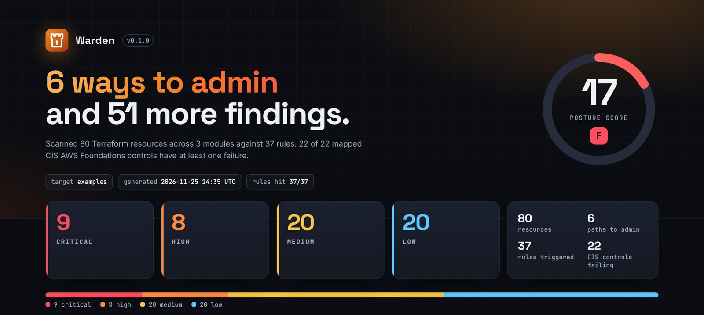
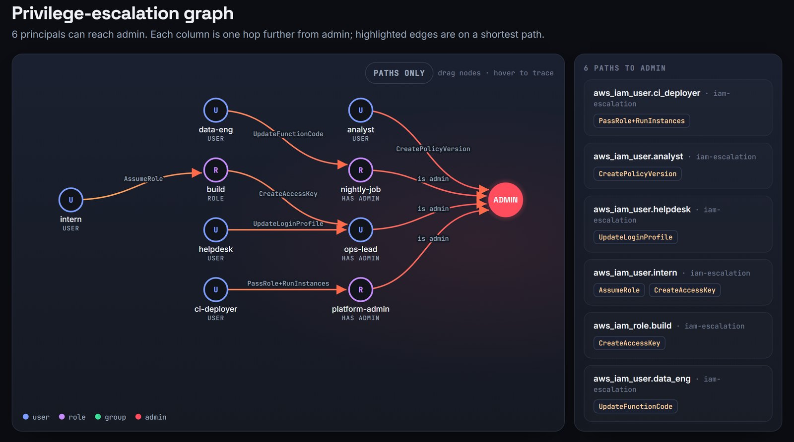
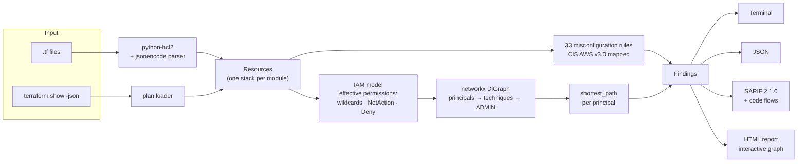
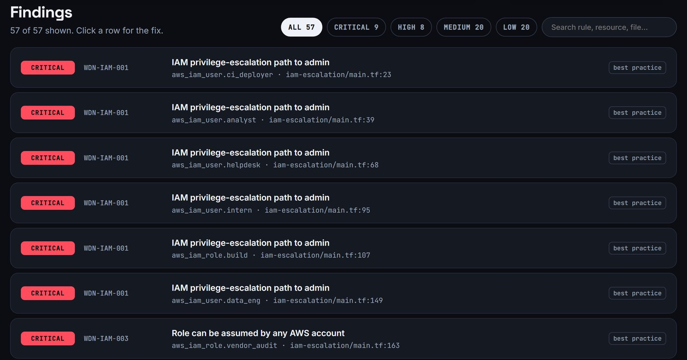

<p align="center"></p>

<h1 align="center">Warden</h1>

<p align="center"><b>Finds the cloud mistakes before <code>terraform apply</code> does.</b><br>An offline cloud security posture tool for AWS Terraform: 37 CIS-mapped checks, an IAM privilege-escalation graph, and SARIF, JSON and HTML reports. No cloud account needed.</p>

<p align="center">
  <a href="https://github.com/alok-kul5/warden-iac/actions/workflows/ci.yml"></a>
  
  
  
</p>



Most IaC scanners check one resource at a time: this bucket is public, that port is
open. Warden does that too, and it also does something per-resource checks can't. It
reads every IAM user, group and role in your Terraform, works out each one's effective
permissions, builds a **networkx graph of escalation techniques**, and finds the
shortest chain that ends at admin.

`helpdesk` can only reset console passwords. `intern` can only assume one build role.
Neither looks dangerous on its own, and both reach admin:



## Setup

Needs Python 3.10+. Nothing else: no Terraform binary, no AWS credentials, no `terraform init`.

```bash
pip install git+https://github.com/alok-kul5/warden-iac
warden scan path/to/terraform                 # coloured terminal output
warden scan infra -f html -o report.html      # the report above
warden scan infra -f sarif -o warden.sarif    # for GitHub code scanning
```

Or from a clone:

```bash
git clone https://github.com/alok-kul5/warden-iac && cd warden-iac
python -m venv .venv
.venv/bin/pip install -e ".[dev]"          # Windows: .venv\Scripts\pip
.venv/bin/warden scan examples/iam-escalation -f html -o report.html
```

To scan a plan instead of the source, which resolves variables, modules and `count`/`for_each`:

```bash
terraform plan -out tf.plan && terraform show -json tf.plan > plan.json
warden scan plan.json
```

| Option | What it does |
|---|---|
| `-f text\|json\|sarif\|html\|markdown\|mermaid` | Output format (`text` is the default) |
| `-o FILE` | Write to a file instead of stdout |
| `--fail-on high` | Exit 1 if any finding is at or above this severity. Use `none` to never fail |
| `--min-severity medium` | Hide findings below this severity |
| `warden rules` | List every rule |

To accept a finding on purpose, put `# warden:ignore WDN-NET-002` inside the resource block.

## Architecture



| Stage | File | Notes |
|---|---|---|
| Parse | [`loader.py`](warden/loader.py), [`hclexpr.py`](warden/hclexpr.py) | Policies come in three shapes: `jsonencode({...})`, heredoc JSON, and `aws_iam_policy_document` blocks. `jsonencode` bodies are HCL, not JSON, so a small recursive-descent parser handles them. Each directory is its own module, as in Terraform. |
| Misconfig rules | [`rules.py`](warden/rules.py) | Cross-resource where AWS splits settings across resources, such as a bucket and its public access block, a VPC and its flow log, or a bucket policy that denies HTTP. Account-level checks run once per root module. |
| IAM | [`iam.py`](warden/iam.py) | Inline, customer-managed and AWS-managed policies (`AdministratorAccess`, `PowerUserAccess`…), group membership, trust policies. Explicit deny wins. |
| Graph | [`iam.py`](warden/iam.py) `build_graph` | Nodes are principals plus an `ADMIN` sink. Edges are techniques. `nx.shortest_path` runs from every non-admin user and role. |
| Report | [`report.py`](warden/report.py), [`html_report.py`](warden/html_report.py) | The HTML report is a single file with the data and scripts embedded, so it works offline as a CI artifact. Web fonts fall back to system fonts when offline. |

### Escalation techniques

These follow the public research on AWS IAM privilege escalation (Rhino Security Labs, Bishop Fox's *iam-vulnerable*):

| Technique | Edge |
|---|---|
| `CreatePolicyVersion`, `SetDefaultPolicyVersion` | rewrite a policy you hold → admin |
| `Attach/Put` `User/Group/RolePolicy` on yourself | grant yourself admin |
| `AddUserToGroup` | join a group that is admin |
| `CreateAccessKey`, `CreateLoginProfile`, `UpdateLoginProfile` | become another user |
| `sts:AssumeRole` where the trust policy allows you | become that role |
| `UpdateAssumeRolePolicy` + `sts:AssumeRole` | make a role trust you, then assume it |
| `iam:PassRole` + EC2 / Lambda / Glue / CloudFormation / CodeBuild / ECS | run compute as a role that trusts that service |
| `lambda:UpdateFunctionCode` | swap the code of a function that runs as a role |

PassRole edges only count when the target role trusts the right service **and** the
actor holds every permission the technique needs. That's why the `reporting` decoy in
the example (PassRole to a Lambda-only role, but no `lambda:CreateFunction`) stays
quiet.

## HTML report

`warden scan <dir> -f html -o report.html` writes one self-contained file. It
includes a posture score and grade, severity counts, and an escalation graph you can
drag, hover to trace or click to highlight a path. Findings filter by severity, search
by rule, resource or file, and expand to show the fix, CIS control, CWE and source
location. Add `#still` to the URL to turn the animations off for screenshots or
printing.



## In GitHub Actions

```yaml
jobs:
  warden:
    runs-on: ubuntu-latest
    permissions:
      contents: read
      security-events: write
    steps:
      - uses: actions/checkout@v5
      - uses: alok-kul5/warden-iac@main
        with:
          path: infra
          fail-on: high
      - uses: github/codeql-action/upload-sarif@v4
        if: always()
        with:
          sarif_file: warden.sarif
      - uses: actions/upload-artifact@v7
        if: always()
        with:
          name: warden-report
          path: warden-report.html
```

Findings land in **Security → Code scanning** with severities set (SARIF
`security-severity`). Privilege-escalation findings carry a **code flow** you can step
through. The job summary gets a Markdown table, and the HTML report is saved as an
artifact. This repo's own CI runs the action on its examples.

## Results

### Labelled fixtures

Every resource that should be flagged carries an `# expect: RULE` comment. The tests
fail on **any** missed or extra finding, and every rule must have at least one
labelled positive case.

| Stack | Resources | Labelled issues | Warden | What it covers |
|---|---:|---:|---:|---|
| [`startup-stack`](examples/startup-stack) | 28 | 37 | 37 caught, 0 extra | Public S3, open SSH/Postgres, open NACL, IMDSv1, public unencrypted RDS with a hardcoded password, HTTP listener, weak trail, `*:*` policy |
| [`iam-escalation`](examples/iam-escalation) | 28 | 19 | 19 caught, 0 extra | Six escalation paths up to two hops, a role anyone can assume, and a PassRole decoy that must **not** fire |
| [`hardened`](examples/hardened) | 24 | 0 | **0 findings** | The same building blocks configured correctly, plus all account controls (Config, Access Analyzer, password policy, EBS default encryption, flow logs, TLS-only bucket policy) |

I wrote these fixtures alongside the rules, so a perfect score here shows the rules do
what they claim. It is not an independent accuracy number. TerraGoat (below) is the
outside check.

### Compared with checkov

The CI `compare` job runs [checkov](https://github.com/bridgecrewio/checkov) 3.4.11 on
the same stacks ([`bench/compare.py`](bench/compare.py), full output in
[`bench/RESULTS.md`](bench/RESULTS.md)). Checkov is credited with a label if it fails
**any** check on that resource, or on a same-named IAM policy, which is generous to
it.

| Stack | Labelled issues | Warden | checkov (any check on the resource) | checkov failed checks |
|---|---:|---:|---:|---:|
| startup-stack | 37 | 37 | 32 | 91 |
| iam-escalation | 19 | 19 | 13 | 36 |
| hardened | 0 | 0 | 0 | 28 |

On the six principals that can reach admin:

| Principal | Path | checkov |
|---|---|---|
| `ci_deployer` | PassRole + RunInstances → admin role | flags the policy (CKV_AWS_286/289/290) |
| `analyst` | CreatePolicyVersion on its own policy | flags the policy (CKV_AWS_288/290) |
| `data_eng` | UpdateFunctionCode on a Lambda that runs as admin | flags the policy (CKV_AWS_286/290) |
| `helpdesk` | UpdateLoginProfile → admin user | only generic hygiene (CKV_AWS_40, CKV_AWS_273) |
| `intern` | AssumeRole → build → CreateAccessKey → admin user | only generic hygiene |
| `build` role | CreateAccessKey → admin user | nothing |

**What this shows.** checkov judges each policy on its own, so it catches the three
cases where one policy is dangerous by itself. It misses the three that need joining
several resources: who trusts whom, who is admin, and which user an ARN points at.
That join is the gap Warden's graph fills.

**Where checkov is ahead.** It has hundreds of AWS checks to Warden's 37. Its 28
failures on `hardened` ([full list](bench/RESULTS.md#what-checkov-flags-on-the-hardened-stack))
are mostly monitoring and resilience extras that Warden doesn't check: CloudTrail to
CloudWatch, RDS Multi-AZ, enhanced monitoring and deletion protection, S3 access
logging, replication and lifecycle rules, customer-managed KMS keys, and security
group descriptions. Two are fair hits on the hardened deploy role, which allows
`ecs:UpdateService` on `*`. One, 90-day password expiry, is advice that current NIST
guidance and CIS v3 dropped. Warden is built to go deeper on IAM, not to replace a
broad scanner. Run both.

### Real-world check: TerraGoat

CI scans [TerraGoat](https://github.com/bridgecrewio/terragoat), a public,
deliberately vulnerable Terraform project, at a pinned commit. Its AWS stack has 70
resources and gives **55 findings** (1 critical, 9 high, 29 medium, 16 low). These
include the world-readable Elasticsearch domain policy, AWS keys in EC2 `user_data`,
Lambda environment variables and the provider block, the public RDS instance, and SSH
open to the internet. The job fails if any of those known issues goes missing.

## Rules

26 of the 37 rules map to a [CIS AWS Foundations Benchmark v3.0.0](https://www.cisecurity.org/benchmark/amazon_web_services)
control. The rest are AWS best practice the benchmark doesn't cover. Every rule
carries a description, a concrete fix and a CWE ID, all of which flow into SARIF and
the HTML report.

| ID | Severity | Check | CIS AWS v3.0 |
|---|---|---|---|
| WDN-IAM-001 | critical | IAM privilege-escalation path to admin | — |
| WDN-IAM-003 | critical | Role can be assumed by any AWS account | — |
| WDN-NET-001 | critical | Security group opens all ports to the internet | 5.2, 5.3 |
| WDN-POL-001 | critical | Resource policy (S3/SQS/SNS/ECR/KMS/OpenSearch/Lambda) allows any principal | — |
| WDN-IAM-002 | high | IAM policy grants every action on every resource | 1.16 |
| WDN-LAMBDA-001 | high | Lambda function URL needs no authentication | — |
| WDN-LOG-004 | high | No CloudTrail trail in this account | 3.1 |
| WDN-NET-002 | high | Security group exposes SSH or RDP to the internet | 5.2, 5.3 |
| WDN-NET-003 | high | Security group exposes a database port to the internet | — |
| WDN-RDS-001 | high | RDS instance is publicly accessible | 2.3.3 |
| WDN-S3-001 | high | S3 bucket ACL grants public access | 2.1.4 |
| WDN-SECRET-001 | high | Hardcoded secret (including nested blocks, `user_data`, provider) | — |
| WDN-EC2-001 | medium | EC2 instance allows IMDSv1 | 5.6 |
| WDN-EC2-002 | medium | EBS volume is not encrypted | 2.2.1 |
| WDN-EFS-001 | medium | EFS file system is not encrypted | 2.4.1 |
| WDN-EKS-001 | medium | EKS API endpoint is public to the whole internet | — |
| WDN-ELB-001 | medium | Load balancer listener serves plain HTTP | — |
| WDN-IAM-004 | medium | Long-lived IAM access key | 1.14 |
| WDN-IAM-005 | medium | Weak IAM password policy | 1.8, 1.9 |
| WDN-LOG-001 | medium | CloudTrail is not multi-region | 3.1 |
| WDN-LOG-003 | medium | CloudTrail logs are not encrypted with KMS | 3.5 |
| WDN-LOG-005 | medium | AWS Config is not recording | 3.3 |
| WDN-LOG-006 | medium | VPC has no flow logs | 3.7 |
| WDN-NET-004 | medium | Network ACL allows SSH or RDP from the internet | 5.1 |
| WDN-NET-005 | medium | Default security group allows traffic | 5.4 |
| WDN-RDS-002 | medium | RDS storage is not encrypted | 2.3.1 |
| WDN-RDS-004 | medium | RDS automated backups are off | — |
| WDN-S3-002 | medium | S3 bucket has no public access block | 2.1.4 |
| WDN-EC2-003 | low | EBS encryption by default is not enabled | 2.2.1 |
| WDN-ECR-001 | low | ECR repository does not scan images on push | — |
| WDN-IAM-006 | low | IAM user has policies attached directly | 1.15 |
| WDN-IAM-007 | low | IAM Access Analyzer is not enabled | 1.20 |
| WDN-KMS-001 | low | KMS key rotation is off | 3.6 |
| WDN-LOG-002 | low | CloudTrail log file validation is off | 3.2 |
| WDN-RDS-003 | low | RDS automatic minor upgrades are off | 2.3.2 |
| WDN-S3-003 | low | S3 bucket versioning is off | — |
| WDN-S3-004 | low | S3 bucket allows plain HTTP requests | 2.1.1 |

## Limits

- **Static by default.** When scanning `.tf` source, values from variables, modules
  and `count`/`for_each` aren't evaluated. An unknown like `var.cidr` is treated as
  unknown, not as open. Scan a plan JSON to get resolved values.
- **Terraform only.** Policies attached outside it (console, CloudFormation, SCPs)
  aren't part of the IAM graph.
- **Simplified conditions.** IAM condition keys and permission boundaries aren't
  evaluated, so a path guarded by a condition may still be reported. Treat a privesc
  finding as "this needs a look", not proof.
- **Account checks are per root module.** Rules like "no CloudTrail" run where a
  `provider "aws"` block is declared, on the assumption that root modules declare
  providers.
- **AWS only** for now.

## Development

```bash
pytest -q                      # 26 tests
python bench/compare.py        # needs checkov (in its own venv: it ships its own hcl2 module)
```

MIT licensed.

---

<sub>One of eleven projects by [Alok Kulkarni](https://alok.is-a.dev): [Hearth](https://github.com/alok-kul5/hearth-iot) home sensors · [Headway](https://github.com/alok-kul5/headway-transit) transit data · [Vigil](https://github.com/alok-kul5/vigil-soc) security triage · [Loupe](https://github.com/alok-kul5/loupe-vision) defect inspection · [Kharcha](https://github.com/alok-kul5/kharcha-finance) personal finance · [Stockroom](https://github.com/alok-kul5/stockroom-inventory) inventory · [Quietwire](https://github.com/alok-kul5/quietwire-villa) smart home design · [Canopy](https://alok.is-a.dev/canopy/) coffee storefront · [Picket](https://github.com/alok-kul5/picket) detection rules · **Warden** cloud IaC scanning · [Marquee](https://github.com/alok-kul5/marquee-recs) recommendations.</sub>
