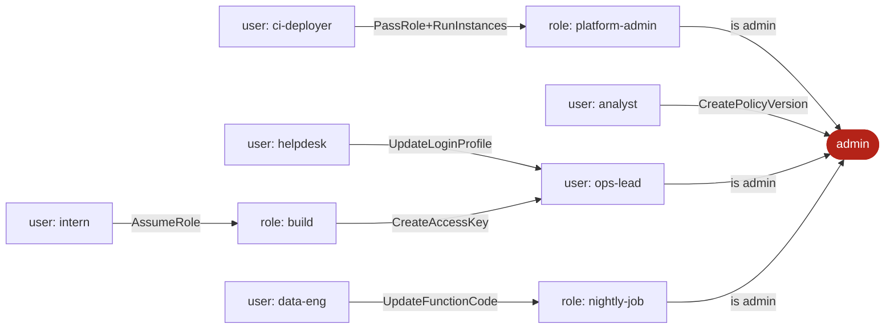
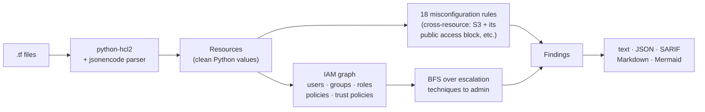

<p align="center"></p>

<h1 align="center">Warden</h1>

<p align="center"><b>Finds the cloud mistakes before <code>terraform apply</code> does.</b><br>A Terraform scanner for AWS that checks misconfigurations and finds IAM privilege-escalation paths, with SARIF output for GitHub code scanning.</p>

[](https://github.com/alok-kul5/warden-iac/actions/workflows/ci.yml)

Most IaC scanners look at one resource at a time: this bucket is public, that port is
open. Warden does that too (22 rules), but it also does something per-resource checks
can't. It builds every IAM user, group and role in your Terraform, works out what
each one is allowed to do, and **searches for chains of permissions that end at
admin**.

Here's an example. `helpdesk` can only reset console passwords, and `intern` can only
assume one build role. Neither looks dangerous on its own. Both reach admin:



*Output of `warden scan examples/iam-escalation -f mermaid`.*

## Quick start

```bash
pip install git+https://github.com/alok-kul5/warden-iac
warden scan path/to/terraform
```

```
CRITICAL WDN-IAM-001  IAM privilege-escalation path to admin
         aws_iam_user.intern  (main.tf:95)
         aws_iam_user.intern
           └─ AssumeRole → aws_iam_role.build
           └─ CreateAccessKey → aws_iam_user.ops_lead
         fix: Remove the first permission in the chain, or scope it to specific resources with a permissions boundary.

HIGH     WDN-NET-002  Security group exposes SSH or RDP to the internet
         aws_security_group.web  (main.tf:37)
         SSH (port 22) open to 0.0.0.0/0
         fix: Use SSM Session Manager, or restrict the rule to a VPN or bastion CIDR.
```

You don't need Terraform, AWS credentials or `terraform init`. Warden reads the `.tf`
files directly, so it runs in a second on a fresh clone or in a pull request.

| Option | What it does |
|---|---|
| `-f text\|json\|sarif\|markdown\|mermaid` | Output format (`text` is the default) |
| `-o FILE` | Write to a file instead of stdout |
| `--fail-on high` | Exit 1 if any finding is at or above this severity. Use `none` to never fail |
| `--min-severity medium` | Hide findings below this severity |
| `warden rules` | List every rule |

To accept a finding on purpose, put `# warden:ignore WDN-NET-002` inside the resource block.

## In GitHub Actions

```yaml
jobs:
  warden:
    runs-on: ubuntu-latest
    permissions:
      contents: read
      security-events: write
    steps:
      - uses: actions/checkout@v4
      - uses: alok-kul5/warden-iac@main
        with:
          path: infra
          fail-on: high
      - uses: github/codeql-action/upload-sarif@v3
        if: always()
        with:
          sarif_file: warden.sarif
```

Findings appear in the repo's **Security → Code scanning** tab with severities set
(SARIF `security-severity`). Privilege-escalation findings include a **code flow**,
so you can step through the chain. The job summary also gets a Markdown table. This
repo runs the action on its own examples in CI.

## Results

Every example stack is labelled: each resource that should be flagged has an
`# expect: RULE` comment, and the tests fail on **any** missed or extra finding.

| Stack | Resources | Findings | What it covers |
|---|---:|---:|---|
| [`examples/startup-stack`](examples/startup-stack/main.tf) | 20 | 21 (2 critical, 7 high) | Public S3, open SSH/Postgres, IMDSv1, public RDS with a hardcoded password, weak CloudTrail, `*:*` policy |
| [`examples/iam-escalation`](examples/iam-escalation/main.tf) | 27 | 7 (all critical) | Six escalation paths up to two hops, plus a PassRole decoy that must **not** be flagged |
| [`examples/hardened`](examples/hardened/main.tf) | 12 | **0** | The same building blocks configured correctly, including GitHub OIDC instead of access keys |

**Real-world check.** CI also scans [TerraGoat](https://github.com/bridgecrewio/terragoat),
a public, deliberately vulnerable Terraform project, at a pinned commit. Its AWS stack
(70 resources) gives **36 findings**. These include the world-readable Elasticsearch
domain policy, AWS keys in EC2 `user_data`, Lambda environment variables and the
provider block, the public RDS instance, and SSH open to the internet. The job fails
if any of those known issues goes missing.

## How it works



**Parsing.** Real Terraform writes policies three ways: `jsonencode({...})`, heredoc
JSON, and `data "aws_iam_policy_document"` blocks. Warden reads all three. `jsonencode`
bodies are HCL expressions, not JSON, so a small recursive-descent parser
([`hclexpr.py`](warden/hclexpr.py)) turns them into data. References like
`aws_iam_role.app.arn` are kept so policies can be matched to the resources they
name.

**Permissions.** For each principal Warden collects inline policies, customer and AWS
managed attachments (`AdministratorAccess`, `PowerUserAccess`, `IAMFullAccess`…), and
group policies through both membership resources. Evaluation follows IAM rules where
it matters: wildcard actions (`iam:Put*`), `NotAction`, resource scoping and
**explicit deny wins**.

**Escalation techniques.** These follow the public research on AWS IAM privilege
escalation (Rhino Security Labs, Bishop Fox's *iam-vulnerable*):

| Technique | Edge |
|---|---|
| `CreatePolicyVersion`, `SetDefaultPolicyVersion` | rewrite a policy you hold → admin |
| `Attach/Put` `User/Group/RolePolicy` on yourself | grant yourself admin |
| `AddUserToGroup` | join a group that is admin |
| `CreateAccessKey`, `CreateLoginProfile`, `UpdateLoginProfile` | become another user |
| `sts:AssumeRole` where the trust policy allows you | become that role |
| `UpdateAssumeRolePolicy` + `sts:AssumeRole` | make a role trust you, then assume it |
| `iam:PassRole` + EC2 / Lambda / Glue / CloudFormation / CodeBuild / ECS | run compute as a role that trusts that service |
| `lambda:UpdateFunctionCode` | swap the code of a function that runs as a role |

A breadth-first search from every non-admin user and role finds the **shortest** path
to admin, up to 5 hops. PassRole edges only count when the target role's trust policy
names the right service and the actor holds every permission the technique needs.
That's why the `reporting` decoy in the example stays quiet.

## Rules

| ID | Severity | Check |
|---|---|---|
| WDN-IAM-001 | critical | Privilege-escalation path to admin |
| WDN-IAM-003 | critical | Role trust policy allows `Principal: "*"` |
| WDN-POL-001 | critical | S3/SQS/SNS/ECR/KMS/OpenSearch/Lambda resource policy open to anyone |
| WDN-NET-001 | critical | Security group open to the internet on all ports |
| WDN-IAM-002 | high | Policy grants `*` on `*` |
| WDN-S3-001 | high | Public S3 ACL |
| WDN-NET-002 | high | SSH/RDP open to the internet (CIS AWS 5.2/5.3) |
| WDN-NET-003 | high | Database or cache port open to the internet |
| WDN-RDS-001 | high | RDS publicly accessible |
| WDN-LAMBDA-001 | high | Lambda function URL with no auth |
| WDN-SECRET-001 | high | Hardcoded passwords, tokens or AWS keys, including nested blocks and `user_data` |
| WDN-S3-002 | medium | No (or partial) S3 public access block |
| WDN-EC2-001 | medium | IMDSv1 allowed (SSRF → instance credentials) |
| WDN-EC2-002 | medium | Unencrypted EBS / root volume |
| WDN-RDS-002 | medium | Unencrypted RDS storage |
| WDN-EKS-001 | medium | EKS API public with no CIDR limit |
| WDN-LOG-001 | medium | CloudTrail not multi-region (CIS AWS 3.1) |
| WDN-IAM-004 | medium | Long-lived IAM access key |
| WDN-S3-003 | low | S3 versioning off |
| WDN-LOG-002 | low | CloudTrail log validation off (CIS AWS 3.2) |
| WDN-KMS-001 | low | KMS key rotation off |
| WDN-ECR-001 | low | ECR scan on push off |

Each rule carries a description, a concrete fix and a CWE ID, all of which flow into the SARIF output.

## Limits

- **Static only.** Values from variables, modules and `count`/`for_each` aren't
  evaluated, so a reference like `var.cidr` is treated as unknown, not as open.
  Warden doesn't flag what it can't see.
- **Terraform only.** Policies attached outside it (console, CloudFormation) aren't
  included in the IAM graph.
- **Simplified conditions.** IAM condition keys and permission boundaries aren't
  evaluated, so a path guarded by a condition may still be reported. Treat a privesc
  finding as "this needs a look", not proof.
- **AWS only** for now.

## Development

```bash
python -m venv .venv && .venv/bin/pip install -e ".[dev]"
pytest -q                     # 22 tests, under 2 seconds
warden scan examples/startup-stack
```

MIT licensed.
